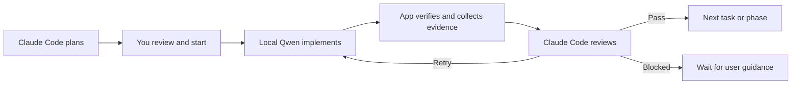
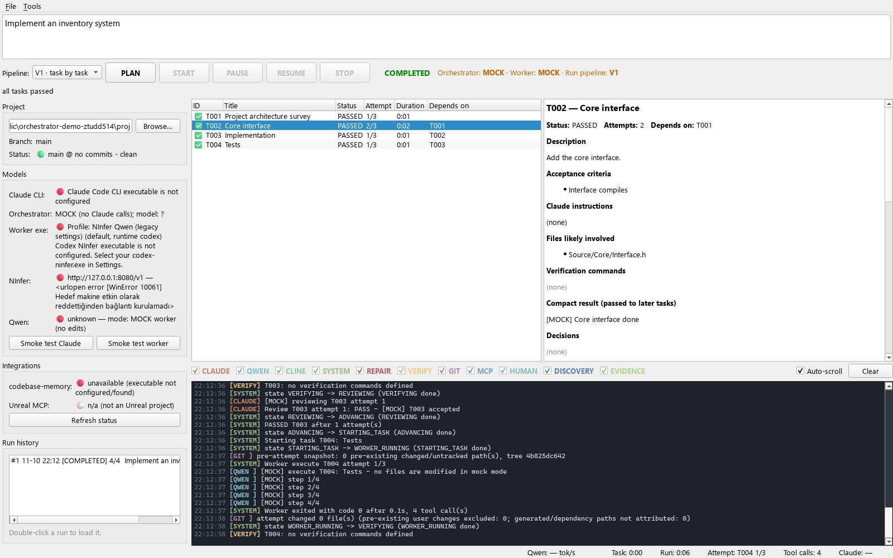

# AI Dev Orchestrator

A Windows desktop app that pairs **Claude Code as the planner and reviewer** with **a local Qwen model as the coding worker**. Give it a goal, review the proposed plan, then let one worker implement it sequentially. The app collects verification results and Git diffs before Claude decides whether the work should advance, retry, or wait for input.

Built with **Python, PySide6, asyncio, SQLite, and Git**.



## What it does

- **Two pipelines.** V1 reviews individual tasks. V2 works in phases, reuses the Codex worker session within a phase, and reviews at checkpoints.
- **Review based on evidence.** Verification results and bounded diffs go to Claude. V2 can also collect runtime evidence or ask the user to verify a result.
- **Bounded repairs.** The phase pipeline compares verification failures across repair attempts, protects acceptance tests, and can restore the best observed repair state.
- **Attributable changes and resumable runs.** A temporary Git index captures before-and-after snapshots. SQLite stores run history and progress so interrupted runs can resume from recorded state.
- **Configurable worker profiles.** Use the dedicated Codex NInfer worker for local Qwen or register a compatible Codex or Cline CLI profile. A real run keeps its selected profile when resumed.

## Run the mock demo

Requires Windows, Python 3.12, and Git on PATH. The default mock configuration runs without Claude Code, a local model, or credentials.

From the repository root in PowerShell:

```powershell
python -m venv .venv
.\.venv\Scripts\python.exe -m pip install -r requirements.txt
.\.venv\Scripts\python.exe -m app.main
```

After setup, you can also double-click `baslat.cmd`.

1. Click **Browse** and select a project folder. You can select this checkout for the mock demo.
2. Leave the pipeline on **V1**, enter a goal such as `Add a health-check command and cover it with a test.`, then click **PLAN**.
3. Review the sample tasks and click **START**. The mock reviewer rejects task `T002` once so you can see the retry cycle. The mock worker leaves your source files untouched.
4. Open **Run history** to inspect a previous run. **PAUSE** waits for the current stage, while **STOP** interrupts it. **RESUME** continues from saved state.



## Run with Claude Code and local Qwen

1. In **Settings → Claude orchestrator**, select the native Claude Code executable and sign in through Claude Code. The app uses the CLI's existing login.
2. Start your local inference backend with Qwen loaded. In **Settings → Worker (Qwen / Codex NInfer)**, select your dedicated `codex-ninfer.exe` and its `CODEX_HOME`. Point that directory's `config.toml` at your backend and set the model to the ID it serves. Set the base URL in the Worker tab for the UI status probe. Optional throughput polling can be enabled in **Settings → Integrations**.
3. Run **Tools → Smoke test Claude Code CLI** and **Tools → Smoke test worker profile (full test)**. Once both pass, select `claude` and `ninfer` under **Settings → Orchestration**.
4. Select the root of a Git repository, click **PLAN**, review the proposed work, then click **START**.

The model and CLI binaries are separate installations. Qwen inference runs locally in this setup. Claude Code may send planning and review context, including repository content, to Anthropic. The GUI and test suite can be exercised with mocks. A complete live run using both adapters was outside this release check.

## Tests

```powershell
.\.venv\Scripts\python.exe -m pytest -q
```

Tests cover the scheduler, retries and recovery, Git attribution, worker adapters, evidence collection, and the Qt interface. The suite blocks real model CLI launches. GitHub Actions runs the suite on Windows on pushes and pull requests. Run the native window capture test locally on an interactive Windows desktop.

See [architecture and implementation notes](docs/architecture.md) for the execution model, evidence providers, and worker profile details.
